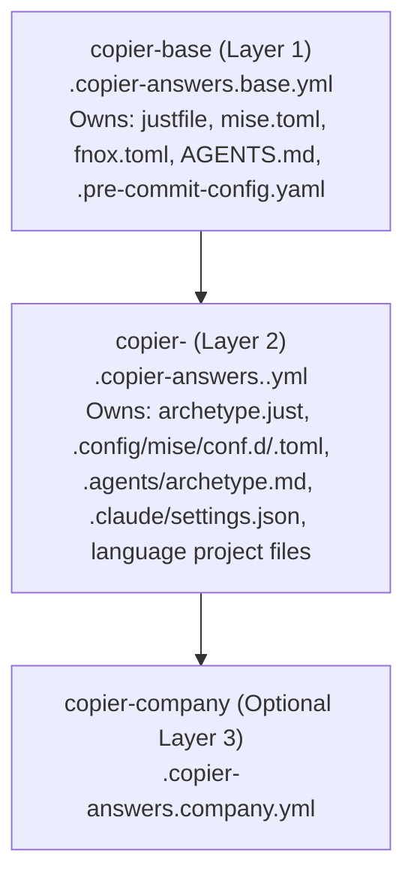

# Plan: Language Archetype Copier Templates (`typescript`, `python`, `laravel-php`, `rust`) (`part14`)

> **Target Assignee:** SWE-2  
> **Execution Context:** Executed inside new repositories bootstrapped via `just -g new ~/projects/templates/copier-<lang>` (copied from `copier-base`), plus wiring in `mydotfiles` (`.chezmoidata.toml`, `dot_justfile`, `dot_omp/seeds/`, `command-guard/normalizer.ts`).  
> **Scope:**
> 1. `AmazingHorse/copier-typescript` (`--archetype typescript`)
> 2. `AmazingHorse/copier-python` (`--archetype python`)
> 3. `AmazingHorse/copier-laravel-php` (`--archetype laravel-php`)
> 4. `AmazingHorse/copier-rust` (`--archetype rust`)

---

## 1. Architecture: How Language Archetypes Layer Over `copier-base`

Per `docs/plans/part8-secrets-and-templates.md`, **every template repository is itself a `copier-base` project** (bootstrapped via `just -g new ~/projects/templates/copier-<lang>`) whose `template/` subdirectory renders the archetype layer on top of any target project:



### Strict File Ownership Contract (Zero Clobbering on `just -g sync-template`)

Every `copier-<lang>` template (`_subdirectory: template`, `_answers_file: .copier-answers.<lang>.yml`) **never** touches files owned by `copier-base` (`justfile`, `mise.toml`, `.config/just/base.just`, `AGENTS.md`). Instead, it populates the exact extension points designed into `copier-base`:

| Extension Point in Target Project | Role in Every `copier-<lang>` Template |
| :--- | :--- |
| `archetype.just` | Overrides `setup`, `check`, `lint`, `test`, `fmt`, `smoke`, `doctor` (wins over `.config/just/base.just` because `import? 'archetype.just'` precedes `import '.config/just/base.just'`). |
| `.config/mise/conf.d/<lang>.toml` | Pins the language runtime and tools (`mise` loads `.config/mise/conf.d/*.toml` automatically alongside `mise.toml`). |
| `.agents/archetype.md` | Language-specific AI coding rules, LSP instructions, architecture conventions, and test patterns (linked from `AGENTS.md` / `CLAUDE.md`). |
| `.config/wt.toml` | Worktrunk (`wt`) hooks: `[post-create]` dependency install + `wt step copy-ignored`; `[pre-merge]` `verify = "just check"`. |
| `.claude/settings.json` + `.devin/config.json` + `.omp/permissions.json` | Seeded once (`_skip_if_exists`) with pre-approved `Bash(...)` rules for that language's compiler, linter, and test runner so Claude Code, Devin CLI, and `omp` work without prompt fatigue from commit #1. |
| Language Manifests & Entrypoints (`_skip_if_exists`) | `package.json`/`tsconfig.json` (TS), `pyproject.toml` (Python), `composer.json`/`phpunit.xml` (Laravel), `Cargo.toml`/`clippy.toml` (Rust) — marked `_skip_if_exists` so `just -g adopt` on an existing repo never overwrites existing manifests! |

---

## 2. Bootstrapping Workflow (Inside a Copied `copier-base` Checkout)

For each language `<lang>` in `typescript`, `python`, `laravel-php`, `rust`:

```bash
# 1. Spawn the template repo itself from copier-base
just -g new ~/projects/templates/copier-<lang>
cd ~/projects/templates/copier-<lang>

# 2. Add template-repo structure
mkdir -p template/.config/mise/conf.d template/.agents template/.claude template/.devin template/.omp
```

Each template repository's own `project.just` defines a `test` recipe that renders `template/` into a temporary directory (`/tmp/smoke-<lang>`), runs `just setup && just check` inside the rendered project, and verifies `copier update` idempotency.

---

## 3. Detailed Specifications for Each Language Template

### 3.1 `copier-typescript` (`gh:AmazingHorse/copier-typescript`)

- **`copier.yml` Questions:**
  - `runtime`: `bun` (default) | `node`
  - `project_kind`: `cli` | `library` | `web-service` | `mcp-server`
  - `_answers_file`: `.copier-answers.typescript.yml`
  - `_skip_if_exists`: `["package.json", "tsconfig.json", "biome.json", "src/index.ts", "tests/index.test.ts", ".claude/settings.json", ".devin/config.json", ".omp/permissions.json"]`
- **`.config/mise/conf.d/typescript.toml`:**
  ```toml
  [tools]
  bun = "1.3.12"
  node = "22.15.0"
  "aqua:biomejs/biome" = "1.9.4"
  ```
- **`archetype.just`:**
  ```just
  setup:
      mise install
      bun install
      pre-commit install

  check: lint typecheck test

  lint:
      bun x biome check .
      pre-commit run --all-files

  typecheck:
      bun x tsc --noEmit

  test:
      bun test

  fmt:
      bun x biome format --write .
  ```
- **Pre-Seeded Permissions (`.claude/settings.json` / `.devin/config.json` / `.omp/permissions.json`):**
  - `allow`: `"Bash(just check *)"`, `"Bash(just test *)"`, `"Bash(just lint *)"`, `"Bash(just fmt *)"`, `"Bash(bun test *)"`, `"Bash(bun x tsc *)"`, `"Bash(bun x biome *)"`
- **`.agents/archetype.md`:**
  - Enforces strict TypeScript (`noImplicitAny`, `noUncheckedIndexedAccess`), `xd://lsp` before `grep`, `Bun.file`/`Bun.write` for `bun` targets, and `just check` before yielding.

---

### 3.2 `copier-python` (`gh:AmazingHorse/copier-python`)

- **`copier.yml` Questions:**
  - `python_version`: `"3.12"` (default) | `"3.13"`
  - `project_kind`: `cli` | `library` | `service-fastapi` | `data-pipeline`
  - `_answers_file`: `.copier-answers.python.yml`
  - `_skip_if_exists`: `["pyproject.toml", "src/{{ project_slug | replace('-', '_') }}/__init__.py", "tests/test_smoke.py", ".claude/settings.json", ".devin/config.json", ".omp/permissions.json"]`
- **`.config/mise/conf.d/python.toml`:**
  ```toml
  [tools]
  python = "{{ python_version }}"
  "aqua:astral-sh/uv" = "0.13.5"
  "aqua:astral-sh/ruff" = "0.11.0"
  ```
- **`archetype.just`:**
  ```just
  setup:
      mise install
      uv sync --all-extras --dev
      pre-commit install

  check: lint typecheck test

  lint:
      uv run ruff check .
      uv run ruff format --check .
      pre-commit run --all-files

  typecheck:
      uv run mypy src tests

  test:
      uv run pytest

  fmt:
      uv run ruff check --fix .
      uv run ruff format .
  ```
- **Pre-Seeded Permissions:**
  - `allow`: `"Bash(just check *)"`, `"Bash(just test *)"`, `"Bash(just lint *)"`, `"Bash(just fmt *)"`, `"Bash(uv run pytest *)"`, `"Bash(uv run ruff *)"`, `"Bash(uv run mypy *)"`
- **`.agents/archetype.md`:**
  - Enforces `src/` layout, full public type annotations, `uv add` / `uv run` (forbids bare `pip` or unisolated `python`), `pytest` fixtures over mocks, and `just check`.

---

### 3.3 `copier-laravel-php` (`gh:AmazingHorse/copier-laravel-php`)

- **`copier.yml` Questions:**
  - `php_version`: `"8.4"` (default) | `"8.3"`
  - `laravel_stack`: `api` | `inertia-react` | `livewire` | `blade`
  - `database`: `sqlite` (default for fast local/worktree tests) | `pgsql` | `mysql`
  - `_answers_file`: `.copier-answers.laravel-php.yml`
  - `_skip_if_exists`: `["composer.json", "phpunit.xml", "pint.json", "phpstan.neon", ".claude/settings.json", ".devin/config.json", ".omp/permissions.json"]`
- **`.config/mise/conf.d/laravel-php.toml`:**
  ```toml
  [tools]
  php = "{{ php_version }}"
  composer = "latest"
  node = "22.15.0"
  bun = "1.3.12"
  ```
- **`archetype.just`:**
  ```just
  setup:
      mise install
      composer install --no-interaction --prefer-dist
      if [[ -f package.json ]]; then bun install; fi
      pre-commit install

  check: lint analyse test

  lint:
      ./vendor/bin/pint --test
      pre-commit run --all-files

  analyse:
      ./vendor/bin/phpstan analyse --memory-limit=1G

  test:
      php artisan test --parallel

  fmt:
      ./vendor/bin/pint
  ```
- **Worktrunk `.config/wt.toml` (Critical for Multi-Agent Laravel Worktrees):**
  - Each agent worktree needs its own isolated SQLite test DB and `.env` so parallel agents running `php artisan migrate:fresh --seed` or `php artisan test` never collide:
    ```toml
    [post-create]
    copy-ignored = "wt step copy-ignored"
    deps = "composer install --no-interaction --prefer-dist"
    sqlite = "touch database/database.sqlite"

    [pre-merge]
    verify = "just check"
    ```
- **Pre-Seeded Permissions:**
  - `allow`: `"Bash(just check *)"`, `"Bash(just test *)"`, `"Bash(just lint *)"`, `"Bash(just fmt *)"`, `"Bash(php artisan test *)"`, `"Bash(php artisan route:list *)"`, `"Bash(php artisan make:*)"`, `"Bash(./vendor/bin/pint *)"`, `"Bash(./vendor/bin/phpstan *)"`, `"Bash(./vendor/bin/pest *)"`
  - `ask`: `"Bash(php artisan migrate:fresh *)"`, `"Bash(php artisan db:wipe *)"`, `"Bash(composer require *)"`
- **`.agents/archetype.md`:**
  - Enforces Larastan (`phpstan`) level compliance, Laravel Pint formatting, FormRequest validation, Feature/Pest tests via `php artisan test`, and strict prohibition against running destructive `migrate:fresh` against non-test databases.

---

### 3.4 `copier-rust` (`gh:AmazingHorse/copier-rust`)

- **`copier.yml` Questions:**
  - `crate_kind`: `bin` (default) | `lib` | `workspace`
  - `edition`: `"2024"` (default) | `"2021"`
  - `_answers_file`: `.copier-answers.rust.yml`
  - `_skip_if_exists`: `["Cargo.toml", "clippy.toml", "rustfmt.toml", "src/main.rs", "src/lib.rs", ".claude/settings.json", ".devin/config.json", ".omp/permissions.json"]`
- **`.config/mise/conf.d/rust.toml`:**
  ```toml
  [tools]
  rust = "stable"
  "aqua:taiki-e/cargo-nextest" = "latest"
  ```
- **`archetype.just`:**
  ```just
  setup:
      mise install
      pre-commit install

  check: lint test

  lint:
      cargo fmt --all -- --check
      cargo clippy --all-targets --all-features -- -D warnings
      pre-commit run --all-files

  test:
      if command -v cargo-nextest >/dev/null 2>&1; then cargo nextest run --all-features; else cargo test --all-features; fi

  fmt:
      cargo fmt --all
  ```
- **Pre-Seeded Permissions:**
  - `allow`: `"Bash(just check *)"`, `"Bash(just test *)"`, `"Bash(just lint *)"`, `"Bash(just fmt *)"`, `"Bash(cargo check *)"`, `"Bash(cargo test *)"`, `"Bash(cargo nextest *)"`, `"Bash(cargo clippy *)"`, `"Bash(cargo fmt *)"`
- **`.agents/archetype.md`:**
  - Enforces zero-warning Clippy (`-D warnings`), `thiserror`/`anyhow` error handling discipline, no avoidable allocations/clones on hot paths, and `xd://lsp` (`rust-analyzer`) for symbol navigation.

---

## 4. Touchpoints in `mydotfiles` to Support the 4 New Archetypes

Once the 4 template repos exist (or alongside their creation), update `mydotfiles`:

1. **`.chezmoidata.toml` (`[templates]` section):**
   ```toml
   [templates]
   base = "gh:AmazingHorse/copier-base"
   infra_ops = "gh:AmazingHorse/copier-infra-ops"
   typescript = "gh:AmazingHorse/copier-typescript"
   python = "gh:AmazingHorse/copier-python"
   laravel_php = "gh:AmazingHorse/copier-laravel-php"
   rust = "gh:AmazingHorse/copier-rust"
   dev_root = "projects/templates"
   ```
2. **`dot_justfile` (`adopt`, `sync-template`, and `dev-clone` recipes):**
   - In `adopt`: expand the `case "$archetype"` statement to resolve `typescript`, `python`, `laravel-php`, and `rust` from `.chezmoidata.toml` (with `COPIER_<ARCHETYPE>_URL` env override support for local testing) and write `.copier-answers.<archetype>.yml`.
   - In `sync-template`: iterate over `for layer in base infra-ops typescript python laravel-php rust company; do ...`.
   - In `dev-clone`: clone all 6 template repos into `~/projects/templates/`.
3. **`dot_omp/private_agent/extensions/command-guard/normalizer.ts`:**
   - Add `composer: true`, `php: true`, `artisan: true` (and ` THREE_WORD_PREFIXES`: `"php artisan": true`, `"cargo nextest": true`) so `php artisan test` normalizes to `"php artisan test"` rather than `"php artisan"`!
4. **`dot_omp/seeds/`:**
   - Add `dot_omp/seeds/rust.md` and `dot_omp/seeds/laravel-php.md` so `just -g seed` also supports standalone seed injection for non-Copier repos.

---

## 5. Verification & Acceptance Criteria

1. **Local Render & Layering Test (`--ref HEAD`):**
   - For each of `typescript`, `python`, `laravel-php`, and `rust`:
     ```bash
     COPIER_BASE_URL=~/projects/templates/copier-base \
     COPIER_TYPESCRIPT_URL=~/projects/templates/copier-typescript \
     just -g new /tmp/test-ts --archetype typescript --ref HEAD
     ```
   - Verify `.copier-answers.base.yml` and `.copier-answers.<lang>.yml` both exist.
   - Verify `just --list` in `/tmp/test-<lang>` shows the language's `archetype.just` recipes overriding `.config/just/base.just`.
2. **Idempotent `adopt` & `sync-template` Test:**
   - Modify `package.json` / `pyproject.toml` / `composer.json` / `Cargo.toml` in `/tmp/test-<lang>`, commit, and run `just -g sync-template /tmp/test-<lang> --ref HEAD`. Verify `_skip_if_exists` preserves the project's manifest modifications untouched.
3. **`command-guard` Prefix Normalization Test (`scripts/omp-permissions.test.ts`):**
   - Verify `php artisan test --parallel` → prefix `"php artisan test"`.
   - Verify `cargo nextest run` → prefix `"cargo nextest run"`.
4. **CI Check:**
   - Run `just test-fast` in `mydotfiles` and confirm 0 errors.
