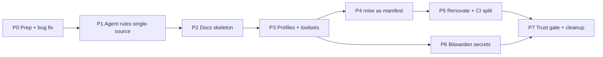

# Implementation plan: mydotfiles → platform + AI SDLC baseline

Source: [part4-review.md](part4-review.md)

## Ground rules

- **Isolation:** all work happens in a separate worktree (`just -g worktree-new <branch>`) so it doesn't collide with omp's session in the main checkout.
- **One phase = one branch = one PR**, Conventional Commits, `just check` green before merge.
- **Incremental:** the mise migration (Phase 4) moves one tool per commit, with CI green on each.
- **Agent targets:** omp, agy, Claude Code, Devin.
- **Secrets:** Bitwarden.
- **Assumed OS targets:** Ubuntu/Debian, WSL, Windows. Server and ephemeral profiles are built but optional.



---

## Phase 0: Prep and quick fix
**Branch:** `fix/wsl-font-json`

| Change | Files |
|---|---|
| Move the embedded PowerShell into a real script. Prefer `pwsh` and fall back to `powershell.exe`. Skip any JSON file that fails to parse **with a warning** instead of `catch {}`. Limit edits to the known editor list (no `%APPDATA%\*` discovery). | `run_onchange_after_install-packages.sh.tmpl`, new `dot_local/share/mydotfiles/configure-terminal-fonts.ps1` |
| Add the new `.ps1` to the CI parse list | `.github/workflows/ci.yml` |
| Add a CI assertion that `bootstrap.sh`'s `DEFAULT_CHEZMOI_VERSION` matches the pin | `scripts/ci-check.sh` |

**Acceptance criteria:** on a Windows Terminal setup whose `settings.json` contains comments, the script either applies the font or prints a clear warning. Comments are never stripped.
**Verify:** `just check`; on Windows, `pwsh -File ...configure-terminal-fonts.ps1 -WhatIf`.

---

## Phase 1: Single-source agent rules (omp / agy / Claude Code / Devin)
**Branch:** `feat/agent-rules-single-source`

| Change | Files |
|---|---|
| Create the canonical core rules (merged from GEMINI.md, cursor-user-rules.md and the user rule). Remove the "automation = Node" contradiction. | new `.chezmoitemplates/agent-core.md` |
| Render the core rules to each tool | `dot_gemini/GEMINI.md.tmpl`, new `dot_claude/CLAUDE.md.tmpl`, `dot_omp/private_agent/AGENTS.md.tmpl` (core + omp contract), Devin global rules target (confirm path; see Open questions) |
| Soften the omp contract: make spec-scope rules conditional on `.agent-spec.md` existing; change LSP to "prefer, where a server exists"; keep hard "never" rules for safety only | `AGENTS.md.tmpl` |
| Generate the Cursor rules file instead of hand-syncing it (kept as a reference copy) | `agent/cursor-user-rules.md` via `just render-rules` |
| Single skills directory: `~/.agents/skills`, symlinked into omp, Claude Code, agy and Devin. agy-crew installs into it. | `run_onchange_after_link-agent-skills.sh.tmpl` |
| MCP server list kept in data and rendered per tool (start empty or with GitHub only) | `.chezmoidata.toml` `[mcp]`, `dot_omp/private_agent/mcp.json.tmpl`, Claude/agy equivalents |
| CI fails if any rendered rules file differs from the core source | `scripts/ci-check.sh` |

**Acceptance criteria:** editing `agent-core.md` once and running `chezmoi apply` updates all four tools. No "keep in sync" comments remain.
**Verify:** `just check`; `chezmoi diff` shows identical core sections in each target.

---

## Phase 2: Docs skeleton (AnyPS5 conventions + Diátaxis + ADRs)
**Branch:** `docs/diataxis-skeleton`

```text
README.md                 # what + 3-command quickstart + doc map
AGENTS.md                 # ≤40 lines: commands, rules agents break, links
CLAUDE.md -> AGENTS.md
CONTRIBUTING.md           # commit style, PR flow, canonical rules
.github/pull_request_template.md   # What / Tested / AI-assisted
docs/
  tutorials/new-machine.md
  how-to/{add-a-tool,add-a-toolset,bump-pins,rotate-ssh-key,add-agent-skill,add-mcp-server}.md
  reference/{pins,just-recipes}.md   # GENERATED
  reference/{layout,env-vars,permissions}.md
  explanation/{agent-control-plane,security-model,platform-matrix}.md
  adr/{0000-template,0001-chezmoi,0002-mise-as-manifest,0003-bash-permission-shim,0004-bitwarden-secrets}.md
  debt.md                 # omp bash-permission SHIM, etc.
```

| Change | Files |
|---|---|
| Slim the README down to the doc map. Move the SSH, git identity and WSL sections into the matching how-to and reference docs. | `README.md`, `docs/**` |
| Turn finished plans into ADRs, then delete the plans | `plans/part2-*.md`, `plans/part3-*.md` → `docs/adr/0003-*` |
| `just docs` generates `pins.md` and `just-recipes.md`. CI runs `just docs && git diff --exit-code`. | `justfile`, `scripts/gen-docs.sh`, `ci.yml` |
| Docs lint: `markdownlint` + `lychee` link check | `.markdownlint.yaml`, `ci.yml` |
| Reusable template: `just -g docs-init` copies the skeleton into any repo | `dot_omp/seeds/docs-skeleton/**`, `dot_justfile` |
| Add the docs and `.chezmoiignore` entries so nothing under `docs/` is applied to `$HOME` | `.chezmoiignore` |

**Acceptance criteria:** a fresh agent session can answer "how do I add a tool?" from `AGENTS.md` → `how-to/add-a-tool.md` without reading installer code.
**Verify:** `just check`; `just docs && git diff --exit-code`; `just -g docs-init` in a scratch repo.

---

## Phase 3: Machine profiles and toolsets
**Branch:** `feat/profiles-toolsets`

| Change | Files |
|---|---|
| `promptChoiceOnce profile` (workstation / server / ephemeral) and `promptBoolOnce toolsets.{infra,containers,rust}`. Choose ephemeral automatically when `$CODESPACES`, `$REMOTE_CONTAINERS` or `!stdinIsATTY` is set. | `.chezmoi.toml.tmpl` |
| Gate fonts, WT/editor edits, agy, omp and agent skills behind `profile == "workstation"` | `run_onchange_*`, `.chezmoiignore` |
| Server profile installs: shell, git, rg/fd, prompt; no sudo prompts unless already root or sudo works non-interactively | install scripts |
| Write `docs/explanation/platform-matrix.md` (profile × OS × what's installed) | docs |

**Acceptance criteria:** `chezmoi init --apply --promptChoice profile=server` in an `ubuntu:24.04` container completes non-interactively, with no fonts and no agents.
**Verify:** `docker run --rm -v $PWD:/src ubuntu:24.04 bash -c '... chezmoi init --apply --source /src --promptChoice profile=server'`

---

## Phase 4: mise as the tool manifest (incremental)
**Branch:** `feat/mise-manifest` (one commit per tool)

Migration order, lowest risk first: `fd` → `rg` → `zoxide` → `delta` → `just` → `agy-crew` (`npm:`) → `oh-my-posh` (last, because the profile checks its version strictly).

For each tool:
1. Add `"aqua:<owner>/<repo>" = "{{ .packages.<pin> }}"` to `dot_config/mise/config.toml.tmpl`.
2. Remove its block from **both** `install-packages.sh.tmpl` and `install-packages.ps1.tmpl`.
3. Remove its URL from `scripts/ci-check.sh`.
4. Run `just check` and commit.

Then:
- Add the core toolset: `gh`, `yq`, `uv`, `shfmt`, `direnv`.
- Add the gated toolsets: infra (`opentofu`, `kubectl`, `helm`, `k9s`, `sops`, `age`; `ansible` via `uv tool`), containers (`hadolint`, `dive`), rust.
- Commit `mise.lock`.
- Clean up old binaries: remove the stale `~/.local/bin/{rg,fd,...}` once the mise shims take over, so PATH order can't shadow them.

**Remains as scripts:** git (PPA/winget), Nerd Fonts, agy installer, chezmoi, mise itself.
**Acceptance criteria:** adding a new tool is a one-line diff, plus a pin, plus a line in `docs/how-to/add-a-tool.md`.
**Verify:** `just check`; `mise doctor`; `mise ls --current`; a fresh container apply (from Phase 3).

---

## Phase 5: Renovate and CI split
**Branch:** `ci/renovate-matrix`

| Change | Files |
|---|---|
| Renovate config: native mise manager plus a regex manager for `.chezmoidata.toml` pins; group minor/patch updates; schedule weekly | `renovate.json` |
| Move URL reachability checks to a scheduled workflow | `.github/workflows/pins-reachable.yml` |
| Install matrix: `ubuntu:22.04`, `ubuntu:24.04`, `debian:12` × `profile=server`; `windows-latest` running the PS installer with `-WhatIf` | `ci.yml` |
| `PSScriptAnalyzer` job | `ci.yml` |
| Pin action SHAs (`actions/checkout@<sha>`) | `ci.yml` |

**Verify:** a PR shows all matrix jobs green; Renovate's onboarding PR detects all pins.

---

## Phase 6: Bitwarden secrets and leak scanning
**Branch:** `feat/bitwarden-secrets`

| Change | Files |
|---|---|
| `private_dot_config/agent-secrets.env.tmpl` using `bitwardenFields`, rendered only on the workstation profile and only when `bw` is unlocked; otherwise skipped with a notice | new |
| Source the secrets file last from `agent-env.sh` / `agent-env.ps1`; support an unmanaged `agent-env.local.sh` override | `dot_config/agent-env.sh.tmpl`, `dot_config/powershell/agent-env.ps1` |
| Install `bw` (or `rbw`) via mise | mise config |
| `gitleaks` in CI and as a pre-commit hook | `ci.yml`, `.pre-commit-config.yaml` |
| ADR 0004 + `docs/explanation/security-model.md` | docs |

**Verify:** `chezmoi apply` with `bw` locked → clear skip message; unlocked → env vars present; `gitleaks detect` passes.

---

## Phase 7: Permission trust gate and cleanup
**Branch:** `feat/permission-trust-gate`

| Change | Files |
|---|---|
| Move build/test commands that can run repo code (`just`, `npm test`, `npm run *`, `pytest`, `cargo build/test`, `go test`, `chezmoi execute-template`, `chezmoi cat`) into a `trustedAllow` tier that applies only when the repo root is listed in `~/.omp/agent/trusted-repos` | `bootstrap-guard.ts`, `permissions.defaults.json` |
| Narrow `git branch` to read-only forms | `permissions.defaults.json` |
| Add a `just -g trust` recipe (asks for confirmation; never agent-writable, since the file is protected) | `dot_justfile` |
| Tests for the trusted vs untrusted decision | `scripts/omp-permissions.test.ts` |
| Merge `seed` and `agent-init`; make `seed` generate a committed `AGENTS.md` skeleton (`.agent-profile.md` stays personal) | `dot_justfile` |
| Wire up the Devin recipes as a real target, or remove them, depending on the Devin path answer | `dot_justfile` |
| `doctor`: pin drift, `chezmoi status`, rendered-rules freshness, profile/toolsets summary | `dot_justfile` |
| Move `run_*` into `.chezmoiscripts/` | repo root |

**Verify:** `bun test scripts/omp-permissions.test.ts`; `just check`; `just -g doctor`.

---

## Open questions

1. **OS targets / environments:** confirm the assumption, or add macOS, servers or devcontainers (this changes Phase 3 scope).
2. **Devin:** which global rules location do you use (Devin CLI, desktop, or web knowledge)? This decides the Phase 1 target and Phase 7's devin recipes.
3. **Bitwarden:** `bw` (official; interactive unlock) or `rbw` (agent-friendly; unlocks in the background)?
4. **MCP:** start with none, or GitHub plus a docs server?
5. **Execution:** should I run the phases myself in a worktree, or write each phase as a `.agent-spec.md` for omp's `just -g run-omp` workflow? The second would exercise your own pipeline.
