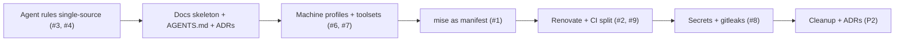

# mydotfiles review: toward a platform-engineering + AI SDLC baseline

Scope: full read of the repo at `6d618eb`, plus your active GitHub repos (`vectra`, `friend-programmer` = TS; `thinkcenter-cluster` = PVE/shell; `flipper` = Python/embedded; `StatcanLM` = Rust) so the toolset advice fits how you actually work.

## Decisions (from Q&A)

| Topic | Decision |
|---|---|
| AI tools to render rules/skills/MCP for | omp, agy, Claude Code, Devin (Devin has `.devin/` rules plus AGENTS.md support, so keep the stubs as a real target, not dead code) |
| Secrets | Bitwarden: chezmoi `bitwarden`/`bitwardenFields` template functions (or `rbw` for an unattended agent), rendered into a `private_` agent-env file |
| mise migration | Incremental, one tool per PR, CI green on each |
| Execution | Advisory now; implement later on a separate worktree branch |
| OS targets / other environments | Unanswered. Assuming the current Ubuntu/Debian + WSL + Windows, and treating server/ephemeral profiles as recommended but optional |

## Verdict

The foundation is **better than most dotfiles I see**: chezmoi, one pin file, checksum-verified bootstrap, CI that renders templates and runs `chezmoi apply` into a temp HOME, a `modify_` template that merges omp config instead of clobbering it, and a tested permission shim. You're already thinking like a platform engineer.

The main risk is **scaling**. Each new tool costs 4 edits in 2 languages, agent rules live in 3 hand-synced copies, and nothing separates a workstation from a server. Fix those three and the repo grows cleanly for years.

---

## P0: Fix these first

### 1. Each new tool costs 4 edits in 2 languages

> **Status: Completed**
> - [x] **Pilot:** Migrated `ripgrep` to `aqua:BurntSushi/ripgrep` in mise; removed custom installer scripts and URL reachability checks.
> - [x] Added `npm:agy-crew` to mise and made skill linking robust via `mise exec`.
> - [x] Remaining tools migrated: `fd`, `git_delta`, `zoxide`, `just`.

To add one CLI today you have to touch:
1. `.chezmoidata.toml` (pin)
2. `run_onchange_after_install-packages.sh.tmpl` (600 lines of bash)
3. `run_onchange_after_install-packages.ps1.tmpl` (517 lines of PowerShell)
4. `scripts/ci-check.sh` (URL reachability list)

**Recommendation: make mise the tool manifest.** You already install mise on both OSes. mise's `aqua:` and `github:` backends install `rg`, `fd`, `delta`, `zoxide`, `just`, `oh-my-posh`, `gh`, `kubectl`, `opentofu`, and others on Linux, macOS and Windows. `aqua:` also verifies checksums and attestations. Then:

```toml
# dot_config/mise/config.toml.tmpl
[tools]
"aqua:BurntSushi/ripgrep" = "{{ .packages.ripgrep }}"
"aqua:sharkdp/fd"         = "{{ .packages.fd }}"
"aqua:dandavison/delta"   = "{{ .packages.git_delta }}"
"aqua:ajeetdsouza/zoxide" = "{{ .packages.zoxide }}"
"aqua:casey/just"         = "{{ .packages.just }}"
"npm:agy-crew"            = "{{ .packages.agy_crew }}"
{{ if .toolsets.infra }}"aqua:opentofu/opentofu" = "1.x"{{ end }}
```

- Bootstrap shrinks to **chezmoi + mise + OS packages** (apt/winget for `zsh`, fonts, `git`).
- Adding a tool becomes **one line**. Commit `mise.lock` for reproducible checksums.
- About 700 lines of hand-rolled download/extract/verify code across both installers go away.
- Exceptions that stay as scripts: git (PPA/winget), Nerd Fonts, agy (self-updating installer).

### 2. Automate pin bumps with Renovate
> **Status: Completed**
> - [x] Configured `.github/renovate.json` with regex manager matching `.chezmoidata.toml` and native mise support.
> - [x] Added Renovate configuration validation and regex pin matching test in `scripts/ci-check.sh`.

Every pin was a manual bump. Renovate now supports mise config and uses a regex manager for `.chezmoidata.toml`. You get a PR per bump, CI runs on it, and you merge. This is the habit that matters for platform work: **pins plus automated, tested bumps**.
### 3. Agent rules in 3 hand-synced copies (they already drift)
> **Status: Completed**
> - [x] Created single canonical source `.chezmoitemplates/agent-core.md` (Node contradiction removed, Conventional Commits added).
> - [x] Rendered to `~/.gemini/GEMINI.md`, `~/.omp/agent/AGENTS.md`, `~/.claude/CLAUDE.md`, and `~/.codex/AGENTS.md` via chezmoi templates.
> - [x] Added `just render-rules` and CI freshness verification for `agent/cursor-user-rules.md`.

**Recommendation:** one source, `.chezmoitemplates/agent-core.md`, included into every target:

| Target | Tool |
|---|---|
| `~/.gemini/GEMINI.md` | agy / Gemini CLI |
| `~/.omp/agent/AGENTS.md` (core + omp contract) | omp |
| `~/.claude/CLAUDE.md` | Claude Code |
| `~/.codex/AGENTS.md` | Codex |
| `agent/cursor-user-rules.md` (rendered by `just`, pasted into Cursor) | Cursor |

Do the same for **skills**: keep them in one directory (for example `~/.agents/skills`, fed by the repo and agy-crew) and symlink it into each tool. Do the same for **MCP servers**: one list in `.chezmoidata`, rendered into each tool's format.

### 4. The global omp contract is too absolute for a global file
> **Status: Completed**
> - [x] Softened LSP priority to prefer LSP where a server exists and allow text search for shell/YAML/Terraform.
> - [x] Made spec scope discipline conditional on `.agent-spec.md` existing.
> - [x] Made verification command fallback to standard project test/check suite.
> - [x] Hard safety invariants preserved (sandbox, secrets, destructive commands).


### 5. Permission allowlist: some "safe" entries can run arbitrary code
> **Status: Completed**
> - [x] Documented threat model trade explicitly in `bootstrap-guard.ts` (now `command-guard/`) SHIM header for repo-defined build/test auto-allows.
> - [x] Gated destructive branch modifications (`git branch -D`, `-d`, `-m`, `-M`, `-c`, `-C`) in `ask` tier.
> - [x] Added unit tests in `scripts/omp-permissions.test.ts` ensuring `git branch` inspection remains allowed while deletion/rename prompts.
---

## P1: Needed for platform engineering

### 6. Machine profiles
> **Status: Completed**
> - [x] Defined `workstation`, `server`, and `ephemeral` profiles in `.chezmoi.toml.tmpl` and `.chezmoidata.toml`.
> - [x] **Completed (2026-10-30):** auto-detects `$CODESPACES` / `$REMOTE_CONTAINERS` and non-TTY (`(not stdinIsATTY)`) in `.chezmoi.toml.tmpl`, skipping prompts unattended and verifying in `scripts/ci-check.sh`.
> - [x] Server profile skips font installations, Windows Terminal edits, agy, and omp via template conditionals and `.chezmoiignore`.
> - [x] Added verification tests for server and workstation profiles in `scripts/ci-check.sh`.


- `server`: shell, git, rg/fd, and the prompt only. No sudo-requiring installs unless asked.
- `ephemeral`: detect `$CODESPACES`, `$REMOTE_CONTAINERS`, or a missing TTY, and skip prompts. chezmoi supports `--promptString`/`--promptBool` for non-interactive init. This makes the repo usable as a **devcontainer dotfiles repo**, which is how you'd sandbox agents on untrusted code.

### 7. Toolsets that match your actual work
> **Status: Completed**
> - [x] Added `infra` (`opentofu`, `kubectl`, `helm`, `k9s`, `sops`, `age`), `containers` (`hadolint`), and `rust` toolset switches to `dot_config/mise/config.toml.tmpl`.
> - [x] Embedded toolchains stay per-project in respective repos.

|---|---|---|
| core | `gh`, `jq`, `yq`, `uv`, `shfmt`, `direnv` (or mise `[env]`) | `uv` replaces pip/pipx/venv; `yq` for every YAML you'll touch |
| infra | `opentofu`, `ansible` (via `uv tool`), `kubectl`, `helm`, `k9s`, `sops`, `age` | `thinkcenter-cluster` → bpg/proxmox provider + ansible is the standard PVE path |
| containers | `podman` or docker CLI, `dive`, `hadolint` | |
| rust | `rust` via mise (rustup) | `StatcanLM` |
| embedded | keep per-project (`flipper` mise.toml + ufbt), as you do now ✅ | Correct call; don't globalize toolchains |

### 8. No secrets story (needed for AI tooling)
> **Status: Completed**
> - [x] Created `dot_config/private_agent-secrets.env.tmpl` rendering Bitwarden secrets when unlocked (`BW_SESSION`).
> - [x] Sourced managed secrets and unmanaged overrides (`~/.config/agent-env.local.sh`, PowerShell equivalent) in shell environments.
> - [x] Secret scanning evaluation (Betterleaks vs Gitleaks).

### 9. CI: split checks that depend on the network from checks that don't
> **Status: Completed**
> - [x] Split network reachability checks into scheduled workflow `.github/workflows/scheduled-reachability.yml`.
> - [x] Added fast network-isolated check support (`CI_SKIP_NETWORK=1` and `just test-fast`).
> - [x] Added container install matrix tests (`ubuntu:22.04`, `ubuntu:24.04`, `debian:12`) under `profile=server`.
> - [x] Added PSScriptAnalyzer and Betterleaks secret scanning steps to `.github/workflows/ci.yml`.
> - [x] Extracted WSL font setup PowerShell script to `dot_local/share/mydotfiles/configure-terminal-fonts.ps1`.
---

## P2: Likely bugs and cleanup

- [x] **Done: WSL font setup on Windows Terminal:** Extracted PowerShell script to `dot_local/share/mydotfiles/configure-terminal-fonts.ps1`. Eliminated cross-boundary Windows invocation from WSL install script. Replaced synchronous `SendMessage` with non-blocking `SendMessageTimeout`. Added JSON comments protection (skips rewrite with warning). Added non-elevated user-space font check in `run_after_zz-wsl-notice.sh.tmpl`.
- [x] **Done:** Moved `run_*` scripts into `.chezmoiscripts/` to declutter the repo root (chezmoi convention).
- [x] **Done:** `bootstrap.sh` pin assertion in `scripts/ci-check.sh` ensuring `DEFAULT_CHEZMOI_VERSION` matches `.chezmoidata.toml`.
- [x] **Done:** Isolated `scripts/ci-check.sh` to a temporary directory config so local CI checks never clobber `$HOME/.config/chezmoi/chezmoi.toml` or `$HOME/.gitconfig`.
- [x] **Done:** Added `git-filter-repo` to package manifests (Linux apt, Windows pip).
- [x] **Completed (2026-10-30):** Removed dead `devin-worktree` and `devin-clean` stubs from `dot_justfile` and cleaned up references in `README.md`.
- [x] **Done:** Finished work orders converted into `docs/adr/0001-0004.md` and `docs/debt.md`.
- [x] **Done:** Enforced Conventional Commits across `CONTRIBUTING.md`, `AGENTS.md`, and `agent-core.md`.
- [x] **Done:** `just -g doctor`: added drift detection, `chezmoi status`, and agent-core template validation.

---

## AI SDLC: getting the most out of models

Your plan → spec → worktree → verify loop (`just -g plan`, `run-omp`, `git-guard`, `worktree-new`) is the right shape. To make it work across every tool:

1. **Every project gets a committed `AGENTS.md`** with build, test, and lint commands, layout, and gotchas. This file affects agent output quality more than anything else. Change `just -g seed` to generate an `AGENTS.md` skeleton. Keep `.agent-profile.md` for *personal* preferences only.
2. **Use `just check` in every repo.** The global contract can then say "run `just check` before reporting done" without knowing the language. You already do this here.
3. **Pre-commit hooks** (shellcheck, shfmt, ruff, prettier, gitleaks) give agents fast, deterministic feedback and catch issues before CI.
4. **Sandbox tiers:** your own repo → native. Unfamiliar repo → `omp-sandbox` (bwrap, nice). Untrusted repo → devcontainer, which the `ephemeral` profile enables.
5. **Single-source skills and MCP**, as in #3. Keep MCP minimal: GitHub plus a docs server covers most value. Each server is attack surface and context cost.

---

## Documentation: a reference structure for humans and agents

### What AnyPS5 does well (checked against `boykopovar/AnyPS5`)
- **`AGENTS.md` is short and lists only "the rules agents break".** The canonical rules live in `CONTRIBUTING.md` and `docs/dev/CONVENTIONS.md`; AGENTS.md links to them and adds a few sharp, testable rules. It doesn't duplicate them.
- **Docs are split by audience:** `docs/user/` (usage, compatibility) and `docs/dev/` (architecture, build, conventions, environment).
- **Known gaps have a fixed home**, one file per component (`docs/dev/debt/<library>.md`). It also states where things *don't* go: "notes, reports and logs go in the PR; add no other files." That stops agents from scattering `NOTES.md` files.
- **Conventions are enforced by tools** (`tools/check_conventions.py`), not just by prose.
- **The PR template has an `AI-assisted` field** and requires every box to be ticked.

### Best-practice alternative: AnyPS5 conventions + Diátaxis + ADRs
AnyPS5's audience split works for a project with users and contributors. A dotfiles/platform repo has one human (you) in different *modes*: onboarding a new machine, doing a task, looking something up, or understanding why it works this way. **[Diátaxis](https://diataxis.fr)** sorts docs by those modes, and it's the most widely adopted docs framework (Django, Canonical, NumPy). Combine it with AnyPS5's agent conventions and add ADRs:

```text
README.md                 # what + 3-command quickstart + doc map. Nothing else.
AGENTS.md                 # ≤40 lines: commands, "rules agents break", links
CLAUDE.md -> AGENTS.md    # symlink (Claude Code); Devin/agy/omp read AGENTS.md
CONTRIBUTING.md           # commit style, PR flow, how to add a tool (the canonical rules)
.github/pull_request_template.md   # What / Tested / AI-assisted
docs/
  tutorials/              # learning: "New machine from zero" (Windows+WSL, Linux)
  how-to/                 # tasks: add-a-tool.md, add-a-toolset.md, rotate-ssh-key.md,
                          #        add-agent-skill.md, add-mcp-server.md, bump-pins.md
  reference/              # facts: pins.md (GENERATED), just-recipes.md (GENERATED),
                          #        layout.md (source path → $HOME path), env-vars.md,
                          #        permissions.md (allow/ask/deny tiers)
  explanation/            # why: agent-control-plane.md, security-model.md,
                          #        platform-matrix.md
  adr/                    # 0001-chezmoi.md, 0002-mise-as-manifest.md,
                          # 0003-bash-permission-shim.md, 0004-bitwarden-secrets.md
  debt.md                 # known gaps/shims (e.g. the omp bash-permission SHIM)
```

### Rules that keep docs useful to agents
1. **One canonical home per fact; everything else links to it.** That's the AnyPS5 rule, and it fixes the 3-copy drift in #3.
2. **Generate reference docs; don't hand-write them.** `just docs` renders `pins.md` from `.chezmoidata.toml` and `just-recipes.md` from `just --list`. CI fails if they're stale (`git diff --exit-code`). This is what keeps docs trustworthy for agents, which take every line literally.
3. **Specific beats vague in AGENTS.md:** exact commands (`just check`), exact paths, "never X, do Y instead". Link to `docs/` for depth so the always-loaded context stays small.
4. **A how-to for every recurring task.** `how-to/add-a-tool.md` becomes the checklist an agent follows when you say "add kubectl". This is the "inevitably include new tools" workflow written down.
5. **Say where things don't go:** "scratch notes go in the PR or `plans/*.local.md`; add no new top-level files."
6. **CI for docs:** `markdownlint`, `lychee` (dead links), and the generated-docs freshness check.
7. **Optional:** a root `llms.txt` (an emerging convention) that indexes `docs/` for tools that fetch repos over the web.

### Making it reusable as a template
Put the skeleton under `dot_omp/seeds/docs-skeleton/` and add a `just -g docs-init` recipe that copies AGENTS.md, CONTRIBUTING.md, the PR template, `docs/{tutorials,how-to,reference,explanation,adr}/` and an ADR template into any repo. `vectra`, `thinkcenter-cluster` and `flipper` would then share one structure that both you and every agent know.

---

## Suggested order



#3/#4 are small and improve every AI session right away. #1 is the largest refactor and is easier once profiles exist to gate it.

---

## Remaining work (audit 2026-10-30, against `94d9511`)

Items above that are still open, or that were marked done but only partly shipped. Each item was re-checked against the tree at `94d9511`. Phases are tracked in [part5-platform-roadmap.md](part5-platform-roadmap.md).

### #1 mise as manifest
- [ ] Commit `mise.lock`.
- [ ] Migrate `oh-my-posh` to mise (still `ensure_pinned_oh_my_posh` in `install-packages.sh.tmpl`).
- [ ] Remove stale `~/.local/bin/{rg,fd,...}` copies that shadow mise shims (`path.sh` puts `~/.local/bin` first).

### #2 / #9 Renovate + CI
- [ ] Renovate: group minor/patch updates and add a weekly schedule.
- [ ] Pin GitHub Action SHAs (`actions/checkout@v5` is still a tag).

### #3 Single-source agent config
- [ ] Devin global rules target. `~/.codeium/windsurf/memories/global_rules.md` is unmanaged and still contains the "automation = Node" contradiction.
- [ ] Single skills directory `~/.agents/skills`, symlinked into omp, Claude Code, agy, and Devin. Today only `agy-crew install --hosts omp` runs.
- [ ] MCP server list in `.chezmoidata.toml`, rendered per tool. `dot_omp/private_agent/mcp.json` is a static empty file.
- [ ] Bring `.cursor/rules/dotfiles-bootstrap.mdc` up to date. It still describes the custom installers (`install_pinned_tarball_binary`, the old pin list), which contradicts `AGENTS.md` rule 4.

### #6 Profiles
- [x] Non-TTY ephemeral detection (see above).
- [x] Remove the duplicated config data. `.chezmoi.toml.tmpl` writes toolset_* and [data.toolsets], and .chezmoidata.toml also defines profile / [toolsets]. Pick one source.

### #7 Toolsets
- [ ] Core: `gh`, `yq`, `uv`, `shfmt` (`direnv` only if mise `[env]` falls short).
- [ ] Infra: `ansible` via `uv tool`.
- [ ] Containers: `podman` (or the docker CLI) and `dive`.

### #8 Secrets
- [ ] Install `bw` (or `rbw`) via mise. The template calls `lookPath "bw"`, but nothing installs it.
- [ ] Locked vault wipes the secrets file. With `BW_SESSION` unset, the template still renders its header, so `chezmoi apply` overwrites `~/.config/agent-secrets.env` with comments only. Fix it with a `.chezmoiignore` gate or by keeping the existing contents.
- [ ] `docs/explanation/security-model.md`.

### AI SDLC
- [ ] `just -g seed` generates a committed `AGENTS.md` skeleton. This is superseded by the copier scaffold in part5 Phase 8.
- [ ] Pre-commit hooks: add `shellcheck` and `shfmt`. Today only generic hooks and betterleaks run.
- [ ] Permission trust gate (`~/.omp/agent/trusted-repos`, `trustedAllow` tier). Not implemented. The old `bootstrap-guard.ts` header documented the threat model; that file is now `command-guard/` (part7).

### Docs
- [ ] `docs/{tutorials,reference,explanation}/` (only `how-to/add-a-tool.md` exists).
- [ ] `just docs` → generated `reference/pins.md` and `reference/just-recipes.md`, with a CI freshness check.
- [ ] `markdownlint` + `lychee` in CI.
- [ ] `docs-skeleton` seed + `just -g docs-init`. Fold this into the copier template (part5 Phase 8).
- [ ] Optional: root `llms.txt`.
