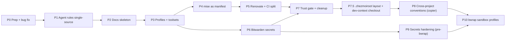

# Implementation plan: mydotfiles → platform + AI SDLC baseline

Source: [part4-review.md](part4-review.md)

## Ground rules

- **Isolation:** all work happens in a separate worktree (`just -g worktree-new <branch>`) so it doesn't collide with omp's session in the main checkout.
- **One phase = one branch = one PR**, Conventional Commits, `just check` green before merge.
- **Incremental:** the mise migration (Phase 4) moves one tool per commit, with CI green on each.
- **Agent targets:** omp, agy, Claude Code, Devin.
- **Secrets:** Bitwarden.
- **Assumed OS targets:** Ubuntu/Debian, WSL, Windows. Server and ephemeral profiles are built but optional.



> **Status (audit 2026-10-30, `94d9511`):** P0–P6 have mostly shipped. The open items are listed in [part4-review.md § Remaining work](part4-review.md#remaining-work-audit-2026-10-30-against-94d9511). P7 is partly done: the cleanup rows have shipped, but the trust tier and the `seed` → `AGENTS.md` rows remain. The command approver was rewritten as `command-guard/` ([part7](part7-command-approver-plan.md), implemented). **Next focus:** P9 (secrets) + a P8 MVP (copier template, first consumer `thinkcenter-cluster`). P7.5 is deferred and does not block the MVP: until the layout move, the template lives at `templates/project/` and is listed in `.chezmoiignore`.

---

## Phase 0: Prep and quick fix
**Branch:** `fix/wsl-font-json`

| Change | Files |
|---|---|
| Move the embedded PowerShell into a real script. Prefer `pwsh` and fall back to `powershell.exe`. Skip any JSON file that fails to parse **with a warning** instead of `catch {}`. Limit edits to the known editor list (no `%APPDATA%\*` discovery). | `run_onchange_after_install-packages.sh.tmpl`, new `dot_local/share/mydotfiles/configure-terminal-fonts.ps1` |
| Add the new `.ps1` to the CI parse list | `.github/workflows/ci.yml` |
| Add a CI assertion that `bootstrap.sh`'s `DEFAULT_CHEZMOI_VERSION` matches the pin | `scripts/ci-check.sh` |

**Acceptance criteria:** on a Windows Terminal setup whose `settings.json` contains comments, the script either applies the font or prints a clear warning. Comments are never stripped.
**Verify:** `just check`; on Windows, `pwsh -File ...configure-terminal-fonts.ps1 -WhatIf`.

---

## Phase 1: Single-source agent rules (omp / agy / Claude Code / Devin)
**Branch:** `feat/agent-rules-single-source`

| Change | Files |
|---|---|
| Create the canonical core rules (merged from GEMINI.md, cursor-user-rules.md and the user rule). Remove the "automation = Node" contradiction. | new `.chezmoitemplates/agent-core.md` |
| Render the core rules to each tool | `dot_gemini/GEMINI.md.tmpl`, new `dot_claude/CLAUDE.md.tmpl`, `dot_omp/private_agent/AGENTS.md.tmpl` (core + omp contract), Devin global rules target (confirm path; see Open questions) |
| Soften the omp contract: make spec-scope rules conditional on `.agent-spec.md` existing; change LSP to "prefer, where a server exists"; keep hard "never" rules for safety only | `AGENTS.md.tmpl` |
| Generate the Cursor rules file instead of hand-syncing it (kept as a reference copy) | `agent/cursor-user-rules.md` via `just render-rules` |
| Single skills directory: `~/.agents/skills`, symlinked into omp, Claude Code, agy and Devin. agy-crew installs into it. | `run_onchange_after_link-agent-skills.sh.tmpl` |
| MCP server list kept in data and rendered per tool (start empty or with GitHub only) | `.chezmoidata.toml` `[mcp]`, `dot_omp/private_agent/mcp.json.tmpl`, Claude/agy equivalents |
| CI fails if any rendered rules file differs from the core source | `scripts/ci-check.sh` |

**Acceptance criteria:** editing `agent-core.md` once and running `chezmoi apply` updates all four tools. No "keep in sync" comments remain.
**Verify:** `just check`; `chezmoi diff` shows identical core sections in each target.

---

## Phase 2: Docs skeleton (AnyPS5 conventions + Diátaxis + ADRs)
**Branch:** `docs/diataxis-skeleton`

```text
README.md                 # what + 3-command quickstart + doc map
AGENTS.md                 # ≤40 lines: commands, rules agents break, links
CLAUDE.md -> AGENTS.md
CONTRIBUTING.md           # commit style, PR flow, canonical rules
.github/pull_request_template.md   # What / Tested / AI-assisted
docs/
  tutorials/new-machine.md
  how-to/{add-a-tool,add-a-toolset,bump-pins,rotate-ssh-key,add-agent-skill,add-mcp-server}.md
  reference/{pins,just-recipes}.md   # GENERATED
  reference/{layout,env-vars,permissions}.md
  explanation/{agent-control-plane,security-model,platform-matrix}.md
  adr/{0000-template,0001-chezmoi,0002-mise-as-manifest,0003-bash-permission-shim,0004-bitwarden-secrets}.md
  debt.md                 # omp bash-permission SHIM, etc.
```

| Change | Files |
|---|---|
| Slim the README down to the doc map. Move the SSH, git identity and WSL sections into the matching how-to and reference docs. | `README.md`, `docs/**` |
| Turn finished plans into ADRs, then delete the plans | `plans/part2-*.md`, `plans/part3-*.md` → `docs/adr/0003-*` |
| `just docs` generates `pins.md` and `just-recipes.md`. CI runs `just docs && git diff --exit-code`. | `justfile`, `scripts/gen-docs.sh`, `ci.yml` |
| Docs lint: `markdownlint` + `lychee` link check | `.markdownlint.yaml`, `ci.yml` |
| Reusable template: `just -g docs-init` copies the skeleton into any repo | `dot_omp/seeds/docs-skeleton/**`, `dot_justfile` |
| Add the docs and `.chezmoiignore` entries so nothing under `docs/` is applied to `$HOME` | `.chezmoiignore` |

**Acceptance criteria:** a fresh agent session can answer "how do I add a tool?" from `AGENTS.md` → `how-to/add-a-tool.md` without reading installer code.
**Verify:** `just check`; `just docs && git diff --exit-code`; `just -g docs-init` in a scratch repo.

---

## Phase 3: Machine profiles and toolsets
**Branch:** `feat/profiles-toolsets`

| Change | Files |
|---|---|
| `promptChoiceOnce profile` (workstation / server / ephemeral) and `promptBoolOnce toolsets.{infra,containers,rust}`. Choose ephemeral automatically when `$CODESPACES`, `$REMOTE_CONTAINERS` or `!stdinIsATTY` is set. | `.chezmoi.toml.tmpl` |
| Gate fonts, WT/editor edits, agy, omp and agent skills behind `profile == "workstation"` | `run_onchange_*`, `.chezmoiignore` |
| Server profile installs: shell, git, rg/fd, prompt; no sudo prompts unless already root or sudo works non-interactively | install scripts |
| Write `docs/explanation/platform-matrix.md` (profile × OS × what's installed) | docs |

**Acceptance criteria:** `chezmoi init --apply --promptChoice profile=server` in an `ubuntu:24.04` container completes non-interactively, with no fonts and no agents.
**Verify:** `docker run --rm -v $PWD:/src ubuntu:24.04 bash -c '... chezmoi init --apply --source /src --promptChoice profile=server'`

---

## Phase 4: mise as the tool manifest (incremental)
**Branch:** `feat/mise-manifest` (one commit per tool)

Migration order, lowest risk first: `fd` → `rg` → `zoxide` → `delta` → `just` → `agy-crew` (`npm:`) → `oh-my-posh` (last, because the profile checks its version strictly).

For each tool:
1. Add `"aqua:<owner>/<repo>" = "{{ .packages.<pin> }}"` to `dot_config/mise/config.toml.tmpl`.
2. Remove its block from **both** `install-packages.sh.tmpl` and `install-packages.ps1.tmpl`.
3. Remove its URL from `scripts/ci-check.sh`.
4. Run `just check` and commit.

Then:
- Add the core toolset: `gh`, `yq`, `uv`, `shfmt`, `direnv`.
- Add the gated toolsets: infra (`opentofu`, `kubectl`, `helm`, `k9s`, `sops`, `age`; `ansible` via `uv tool`), containers (`hadolint`, `dive`), rust.
- Commit `mise.lock`.
- Clean up old binaries: remove the stale `~/.local/bin/{rg,fd,...}` once the mise shims take over, so PATH order can't shadow them.

**Remains as scripts:** git (PPA/winget), Nerd Fonts, agy installer, chezmoi, mise itself.
**Acceptance criteria:** adding a new tool is a one-line diff, plus a pin, plus a line in `docs/how-to/add-a-tool.md`.
**Verify:** `just check`; `mise doctor`; `mise ls --current`; a fresh container apply (from Phase 3).

---

## Phase 5: Renovate and CI split
**Branch:** `ci/renovate-matrix`

| Change | Files |
|---|---|
| Renovate config: native mise manager plus a regex manager for `.chezmoidata.toml` pins; group minor/patch updates; schedule weekly | `renovate.json` |
| Move URL reachability checks to a scheduled workflow | `.github/workflows/pins-reachable.yml` |
| Install matrix: `ubuntu:22.04`, `ubuntu:24.04`, `debian:12` × `profile=server`; `windows-latest` running the PS installer with `-WhatIf` | `ci.yml` |
| `PSScriptAnalyzer` job | `ci.yml` |
| Pin action SHAs (`actions/checkout@<sha>`) | `ci.yml` |

**Verify:** a PR shows all matrix jobs green; Renovate's onboarding PR detects all pins.

---

## Phase 6: Bitwarden secrets and leak scanning
**Branch:** `feat/bitwarden-secrets`

| Change | Files |
|---|---|
| `private_dot_config/agent-secrets.env.tmpl` using `bitwardenFields`, rendered only on the workstation profile and only when `bw` is unlocked; otherwise skipped with a notice | new |
| Source the secrets file last from `agent-env.sh` / `agent-env.ps1`; support an unmanaged `agent-env.local.sh` override | `dot_config/agent-env.sh.tmpl`, `dot_config/powershell/agent-env.ps1` |
| Install `bw` (or `rbw`) via mise | mise config |
| `gitleaks` in CI and as a pre-commit hook | `ci.yml`, `.pre-commit-config.yaml` |
| ADR 0004 + `docs/explanation/security-model.md` | docs |

**Verify:** `chezmoi apply` with `bw` locked → clear skip message; unlocked → env vars present; `gitleaks detect` passes.

---

## Phase 7: Permission trust gate and cleanup
**Branch:** `feat/permission-trust-gate`

| Change | Files |
|---|---|
| Move build/test commands that can run repo code (`just`, `npm test`, `npm run *`, `pytest`, `cargo build/test`, `go test`, `chezmoi execute-template`, `chezmoi cat`) into a `trustedAllow` tier that applies only when the repo root is listed in `~/.omp/agent/trusted-repos`. Note: `chezmoi execute-template` was moved into plain `allow` by part7; decide whether it moves back | `command-guard/rules.ts`, `command-guard/store.ts`, `permissions.defaults.json` |
| ~~Narrow `git branch` to read-only forms~~ (done: destructive forms are in `ask`, part4 #5) | `permissions.defaults.json` |
| Add a `just -g trust` recipe (asks for confirmation; never agent-writable, since the file is protected) | `dot_justfile` |
| Tests for the trusted vs untrusted decision | `scripts/omp-permissions.test.ts` |
| ~~Merge `seed` and `agent-init`~~ (done). Committed `AGENTS.md` generation is superseded by the copier template (P8) | `dot_justfile` |
| ~~Wire up or remove the Devin recipes~~ (done: removed in `00d6aaa`) | `dot_justfile` |
| ~~`doctor`: pin drift, `chezmoi status`, rendered-rules freshness~~ (done, part4 P2) | `dot_justfile` |
| ~~Move `run_*` into `.chezmoiscripts/`~~ (done) | repo root |

**Verify:** `bun test scripts/omp-permissions.test.ts`; `just check`; `just -g doctor`.

---

## Phase 7.5: `.chezmoiroot` layout and dev-context checkout
**Branch:** `refactor/chezmoiroot`

**Goal:** separate "what lands in `$HOME`" from "repo-only material", and don't check out development material (project templates, docs, plans, CI scripts) on machines that aren't dev machines. Dev context = **`profile == "workstation"`** (no new toggle).

Target layout:

```text
.chezmoiroot              # contains: home
home/                     # chezmoi source state (everything chezmoi reads)
  .chezmoi.toml.tmpl  .chezmoidata.toml  .chezmoiignore
  .chezmoiscripts/  .chezmoitemplates/
  dot_* private_* dot_config/ dot_omp/ dot_local/ dot_justfile ...
templates/project/        # personal base copier template (Phase 8)
copier.yml                # copier entrypoint (_subdirectory: templates/project); verify before relying on it
docs/  plans/  scripts/  agent/  .github/  .cursor/
README.md AGENTS.md CLAUDE.md CONTRIBUTING.md LICENSE justfile
bootstrap.sh bootstrap.ps1 setup-ssh.sh setup-ssh.ps1 .pre-commit-config.yaml
```

| Change | Files |
|---|---|
| Add `.chezmoiroot` (`home`). Use `git mv` to move every chezmoi source entry into `home/` in one commit with no content changes, so `git log --follow` still works | repo root → `home/` |
| Cut `.chezmoiignore` down to target-path rules only. Repo-only entries (`README.md`, `docs/`, `scripts/`, `plans/`, …) are no longer needed because they sit outside `home/` | `home/.chezmoiignore` |
| Update the hardcoded source paths (≈75 references) | `scripts/ci-check.sh`, `.github/workflows/*.yml`, `.github/renovate.json` (`fileMatch` → `home/dot_config/mise/...`, `home/.chezmoidata.toml`), `justfile` (`render-rules`), `bootstrap.sh` / `bootstrap.ps1` (pin reads, local-checkout link), `CONTRIBUTING.md`, `AGENTS.md`, `docs/**`, `.cursor/rules/*.mdc` |
| Non-workstation checkout: bootstrap clones with `--filter=blob:none`. A `run_once_after_` script (non-workstation profiles only) runs `git -C "$(chezmoi source-path)/.." sparse-checkout set --cone home` (plus the root files bootstrap needs). Workstation keeps the full checkout. If the profile changes later, the same script re-runs via a `run_onchange_` hash of `.profile` and widens or narrows the checkout | `bootstrap.sh`, `bootstrap.ps1`, new `home/.chezmoiscripts/run_onchange_after_sparse-checkout.{sh,ps1}.tmpl` |
| Local dev checkouts: the `~/.local/share/chezmoi` → repo symlink/junction rule is unchanged (it still points at the repo root; `.chezmoiroot` handles the rest) | `bootstrap.*` |
| CI: assert `chezmoi source-path` ends in `/home`, run the existing dry-run/apply matrix unchanged, and add a server-profile container job asserting `templates/` and `docs/` are absent after bootstrap | `scripts/ci-check.sh`, `ci.yml` |
| ADR 0006: `.chezmoiroot` + profile-driven sparse checkout | `docs/adr/0006-chezmoiroot-sparse-checkout.md` |

**Acceptance criteria:** `chezmoi diff` on this workstation is empty right after the move (the move is invisible to `$HOME`). A `profile=server` container bootstrap has no `templates/`, `docs/`, `plans/` or `scripts/` in the source checkout. `chezmoi update` works on both.
**Verify:** `just test`; `chezmoi diff` (expect no output); container bootstrap with `--promptChoice profile=server` then `ls "$(chezmoi source-path)/.."`.

---

## Phase 8: Cross-project conventions (copier)
**Branch:** `feat/project-template`

**Goal:** moving between repos (TS, Python, Rust, shell/infra, embedded) should feel the same. Each repo answers the same five questions the same way, and conventions can be updated in existing repos, not just at creation.

| Question | Convention |
|---|---|
| What tools? | Per-repo `mise.toml` (toolchain pins + `[env]`). mise activation switches toolchains on `cd`. Global mise stays CLI-only. |
| How do I work in it? | `justfile` with fixed verbs: `setup`, `check`, `test`, `fmt`, `lint`, `run`, `build` (unused verbs print "n/a" and exit 0). `just check` is the only gate that agents, pre-commit, and CI call. **just stays the interface; mise is only for tools/env.** |
| What env / IO? | `.env.example` committed. Real values come from mise `[env]` plus per-project Bitwarden secrets injected at command time (Phase 9). Inputs in `data/`, outputs in `out/`, both gitignored. |
| How do agents behave? | Committed `AGENTS.md` (≤40 lines: verbs, layout, rules agents break) rendered from seed + archetype. `.agent-profile.md` stays personal and ignored. |
| How trusted is it? | Per-repo sandbox profile (network, extra binds, which secret item), consumed by Phase 10. |

| Change | Files |
|---|---|
| Personal base copier template at `templates/project/` in this repo (outside `home/`, so only on workstation checkouts), with root `copier.yml` using `_subdirectory`. Ask the questions `lang` (`typescript-node`, `python`, `rust`, `systems-shell`, `minimal`), `archetype` (`agent-cli`, `data-pipeline`, `infra-ops`, `legacy-port`, none), `ci` (bool), `devcontainer` (bool). Reuse `dot_omp/seeds/*` and `dot_omp/archetypes/*` as template partials so there is one source. | new `templates/project/**` |
| Template outputs: `mise.toml`, `justfile` (verbs above, per-lang bodies), `AGENTS.md`, `.editorconfig`, `.gitignore` (incl. `.agent-spec.md`, `.agent-profile.md`, `data/`, `out/`, `.env`), `.env.example`, `.pre-commit-config.yaml` (betterleaks + per-lang linters), `.github/workflows/ci.yml` (runs only `just check`), `.github/pull_request_template.md`, `docs/{how-to,reference,explanation,adr}/` + ADR template, optional `.devcontainer/devcontainer.json` using this repo with `profile=ephemeral` | template |
| Company overlays as **separate private copier templates**, one repo per company (e.g. `<company>-project-template`), applied on top of the personal base. Copier supports several templates per project, each with its own answers file (`.copier-answers.yml` for the base, `.copier-answers.<company>.yml` for the overlay). An overlay owns only company-specific files: the secrets-injection settings (`secrets_org = "<company>"` → Bitwarden `<company>/<repo>`), company CI, CODEOWNERS, license headers, and extra `AGENTS.md` rules via an include block the base template provides. Nothing company-specific goes in this public repo | external private repos; base template exposes overlay hook points |
| Add `copier` via mise (`pipx:copier` or `uv`-backed), workstation profile only | `home/dot_config/mise/config.toml.tmpl`, `home/.chezmoidata.toml` pin |
| `just -g new <dir> [--company <name>]` → `copier copy` base, then the overlay if `--company` is given. `just -g adopt` → copier into an existing repo (no overwrite without a diff). `just -g sync-template` → `copier update` for every `.copier-answers*.yml` found. The company → template URL map lives in an unmanaged local file (`~/.config/mydotfiles/companies.toml`), so employer names never land in this repo | `home/dot_justfile` |
| Retire `seed` / `agent-init` (or keep `seed` as a thin alias for `.agent-profile.md` only) | `dot_justfile` |
| Global agent rule: "in any repo, discover verbs via `just --list`; `just check` before reporting done" | `.chezmoitemplates/agent-core.md` |
| ADR 0005: copier for project templates (why not one-shot copy / cookiecutter) | `docs/adr/0005-copier-project-templates.md` |

**Acceptance criteria:** `just -g new /tmp/demo` with `lang=python` produces a repo where `just check` passes on first run. Changing the template and running `just -g sync-template` in that repo shows a reviewable diff.
**Verify:** scratch repos for each `lang`: `just setup && just check`. Run `copier update` after a template change.

---

## Phase 9: Secrets hardening (prerequisite for bwrap)
**Branch:** `fix/secrets-hardening`

Decisions: **Bitwarden item per project**, fetched when a command runs. **The global agent env keeps auto-sourcing for now** and is revisited in Phase 10.

| Change | Files |
|---|---|
| Fix the locked-vault wipe: when `bw` is locked or missing, skip the target (`.chezmoiignore` conditional on `env "BW_SESSION"`) instead of rendering an empty file over real keys | `.chezmoiignore`, `private_agent-secrets.env.tmpl` |
| Install `rbw` (agent-friendly background unlock) or `bw` via mise and pin it. Decide between them here (open question 3). | mise config, `.chezmoidata.toml` |
| Per-project convention: a Bitwarden item named `<org>/<repo>` (custom fields = env vars; `org` = `proj` for personal, company prefix for work, mapped from the git remote owner). `just -g with-secrets -- <cmd>` resolves the item name, fetches that item, and execs `<cmd>` with those vars only in its env. It never writes to disk. | `dot_justfile` (or `dot_local/bin/executable_with-secrets`) |
| Copier template's `justfile` exposes `run`/`dev` through `with-secrets` when the project declares `secrets = true` | template |
| `docs/explanation/security-model.md`: what's global (agent API keys), what's per-project, what never leaves Bitwarden | docs |

**Verify:** apply with a locked vault keeps `agent-secrets.env` unchanged. `just -g with-secrets -- env` inside a repo shows only that project's vars. `betterleaks` stays clean.

---

## Phase 10: bwrap sandbox profiles (to be designed)
**Branch:** `feat/sandbox-profiles`

Scope for the next discussion. Known gaps in today's `just -g omp-sandbox`:
- `--ro-bind / /` exposes `~/.ssh`, `~/.config/agent-secrets.env`, browser profiles, and `/mnt/c` read-only. Switch to an allowlist: system dirs (`/usr`, `/etc` subset, `/lib*`), mise installs, the repo, and per-tool state dirs.
- No `--clearenv`: `BW_SESSION`, every agent key, and `SSH_AUTH_SOCK` are inherited. Pass through an explicit env list, plus the project's secrets from Phase 9.
- No `--unshare-*`: network, pid, and ipc are shared. Default to `--unshare-all` and re-enable `--share-net` per profile (agents need their model API, which argues for an egress allowlist via a proxy rather than all-or-nothing).
- Profile source: a per-repo sandbox block (from the Phase 8 template) consumed by a single launcher used by omp, agy, Claude Code, and Devin, not an omp-only recipe.
- Once it's in place, revisit `docs/debt.md` #1 (`command-guard/`) and the Phase 7 trust tier, since OS-level confinement covers part of their job.

---

## Open questions

1. **OS targets / environments:** confirm the assumption, or add macOS, servers or devcontainers (this changes Phase 3 scope).
2. **Devin:** which global rules location do you use (Devin CLI, desktop, or web knowledge)? This decides the Phase 1 target and Phase 7's devin recipes.
3. **Bitwarden:** `bw` (official; interactive unlock) or `rbw` (agent-friendly; unlocks in the background)?
4. **MCP:** start with none, or GitHub plus a docs server?
5. **Execution:** should I run the phases myself in a worktree, or write each phase as a `.agent-spec.md` for omp's `just -g run-omp` workflow? The second would exercise your own pipeline.
6. ~~Copier template location~~, 7. ~~Bitwarden item naming~~, 8. ~~Dev-context checkout~~, 9. ~~Company overlays~~: all decided below.
10. **Copier `_subdirectory` + `copier update` from a repo shared with dotfiles:** check against the copier docs, and confirm in a spike that update provenance (`_commit`) works with untagged dotfiles history (`--vcs-ref HEAD`), before Phase 8 depends on it.

### Decided (2026-10-28)
- Scaffolding: **copier** (updatable templates).
- Task runner: **just** stays the per-repo interface; mise only for tools/env.
- Per-project secrets: **Bitwarden item per project**, injected when a command runs.
- Item naming: **`<org>/<repo>`**. `proj/<repo>` for personal projects, `<company>/<repo>` for employer work. The org is derived from the git remote owner via a mapping table in `.chezmoidata.toml`, with an optional per-repo override in the project's sandbox/secrets block.
- Global agent keys: **keep auto-sourcing for now**; revisit with Phase 10.
- Layout: **`.chezmoiroot = home`**. The personal base copier template lives at `templates/project/` in this repo (Phase 7.5 / 8).
- Dev context: **`profile == "workstation"`** gets the full checkout plus copier. Other profiles use a partial clone and the sparse cone `home`.
- Company-specific template info (secrets injection, CI, CODEOWNERS): **separate private copier overlay templates** layered on the personal base, never stored in this repo.

---

## Day to day once these phases land

**New machine.** Run `bootstrap.sh` or `bootstrap.ps1` and answer the profile prompt. A workstation gets the full checkout (templates, docs, copier, agents, fonts). A server or ephemeral box gets a partial clone of `home/` only: shell, git, rg/fd, prompt, no agents. After that, `just update` keeps it current. Renovate opens PRs for pin bumps, CI tests them, and you merge them.

**Starting a project.** `just -g new ~/projects/foo` asks for language, archetype, CI, and devcontainer. Add `--company acme` to layer the private overlay. The result has the same shape every time: `mise.toml`, a `justfile` with `setup/check/test/fmt/lint/run/build`, a committed `AGENTS.md`, `.env.example`, pre-commit, a CI workflow that runs `just check`, and `docs/` with an ADR folder. Existing repos are brought in line with `just -g adopt`.

**Switching projects.** When you `cd` into a repo, mise switches toolchains and env. `just --list` shows the same verbs everywhere. You never need to remember whether a project is npm, uv, or cargo, because `just check` is the answer in all of them. `just -g sync-template` pulls convention changes into older repos as a reviewable diff.

**Secrets.** Day to day nothing changes for global agent keys. Project secrets live in Bitwarden as `<org>/<repo>` and only enter a process through `just run` or `just -g with-secrets -- <cmd>`. They are never written to disk or exported to your whole shell. An apply with a locked vault no longer erases anything.

**Agents.** Every harness (omp, agy, Claude Code, Devin) reads the same rendered core rules, the same skills directory, and the repo's `AGENTS.md`. Work follows plan → `.agent-spec.md` → worktree → `just check`. Unfamiliar or infra-touching repos run inside the bwrap launcher, which gives the agent only the repo, its own state, the project's secrets, and the network the repo's sandbox profile allows.

**Maintenance.** `just -g doctor` reports pin drift, chezmoi status, whether the rendered rules are fresh, and the profile summary. Debt has one home (`docs/debt.md`) and decisions have another (`docs/adr/`).

---

## After the roadmap: distributed-systems / platform-engineering practice

### Recommendation: return to `thinkcenter-cluster`, but don't wait for every phase

The dotfiles are now good enough that more polish has diminishing returns, and none of it builds distributed-systems experience. Do the minimum that makes the cluster the **first real consumer** of these conventions, then switch:

1. **Must do first:** Phase 7.5 (layout) → the parts of Phase 8 needed to run `just -g adopt` on the cluster repo → the locked-vault fix from Phase 9.
2. **Do alongside the cluster:** Phase 10 (bwrap). Agents that can reach `192.168.50.0/24` and run Ansible against live nodes are exactly the case the sandbox profile exists for, so design it against that real need.
3. **Do opportunistically:** docs generation, markdownlint/lychee, Renovate grouping, the remaining part4 toolset gaps, Phase 7's trust tier.

### What adopting the conventions means for `thinkcenter-cluster` (as of `dbd142c`)
- **State:** 3× M910q (16 / 8 / 8 GB). PVE 9.2 PXE + unattended install, then Ansible (corosync, OSPF full-mesh fabric via frr, Ceph Tentacle), then SOPS + age. Terraform is a stub. The last ~15 commits (Aug 2026) are PXE/initrd debugging, which is where the project stalled.
- `just -g adopt`: move `.agents/AGENTS.md` to a root `AGENTS.md` with the `infra-ops` archetype. Map the existing recipes onto the standard verbs (`check` = lint + `ansible-playbook --syntax-check` + `sops` check; keep `standup/bootstrap/site` as project verbs). Add `mise.toml` pinning `ansible` (via uv), `opentofu`, `sops`, `age`. Move `fetch_assets_justfile_plan.md` into `docs/` or delete it.
- **Secrets:** the cluster already uses sops + age, which fits. Bitwarden item `proj/thinkcenter-cluster` holds the **age private key**, and `with-secrets` exports `SOPS_AGE_KEY` only for `just site` / `ansible-playbook`, replacing `~/.config/sops/age/keys.txt` on disk.

### Getting unstuck: PXE is a side quest
PXE plus an initrd-embedded ISO is boot plumbing, not distributed systems. Time-box it. If it isn't working after one more session, install from USB with the same answer file (`proxmox-auto-install-assistant prepare-iso --fetch-from http` against the existing nginx answer endpoint), get all three nodes into Ansible, and come back to PXE later as its own task. The learning starts once corosync and Ceph are up.

### Learning path (each stage ends with a written runbook or postmortem in `docs/`)

| Stage | Build | Distributed-systems concept you'll actually hit |
|---|---|---|
| 1. Cluster formation | `site.yml` to green on 3 nodes; corosync 2 rings; Ceph 3 MON + 3 OSD | Quorum (why 3, not 2), membership, replication factor vs. available RAM/disk |
| 2. Failure drills | Pull a mesh cable, pull a node, fill an OSD, kill a MON. Use `tc netem` on cluster links for latency/loss | OSPF reconvergence, corosync token timeouts, Ceph degraded → recovery/backfill, split-brain prevention, recovery-time budgets |
| 3. Observability | Prometheus + Grafana + Loki (pve/node/ceph exporters), alerting, 2–3 SLOs | The metrics/logs/traces split, SLIs vs. symptoms, alert fatigue |
| 4. IaC for workloads | Terraform `bpg/proxmox` provider for VMs/templates; cloud-init; CI plan on PR, apply via a gated job on the self-hosted runner | Declarative reconciliation, drift, state locking |
| 5. Kubernetes on top | Talos (or k3s) with 3 control-plane VMs, Ceph CSI (external Rook) for PVs, Cilium, cert-manager, external-secrets, Argo CD/Flux GitOps | etcd quorum *on top of* corosync quorum (failure-domain thinking), controllers/reconcile loops, CSI/CNI |
| 6. Stateful distributed workloads | CloudNativePG (replicated Postgres), NATS JetStream or Redpanda, Chaos Mesh experiments | Leader election, replication lag, consistency vs. availability under partition, idempotent consumers |
| 7. Platform layer | A copier "service" template that deploys to the cluster (Dockerfile, k8s manifests/Helm, CI, SLO dashboard stub), so the golden path is something you built | Platform-as-product: paved roads, self-service, guardrails |

**Constraints to plan around:** 32 GB total RAM, with Ceph and ZFS ARC taking a share, makes 3 control-plane VMs plus workers tight. Keep Talos/k3s nodes small, or run control planes on `pve01`'s headroom and accept a less even failure domain for a while (and write that tradeoff down as an ADR). The 1G shared management NIC limits VM and Ceph public traffic until the Mikrotik VLAN phase.

**Reading alongside:** *Designing Data-Intensive Applications* (Kleppmann) for stages 2 and 6, and the Google *SRE* book's chapters on SLOs and postmortems for stages 3 and 7.
