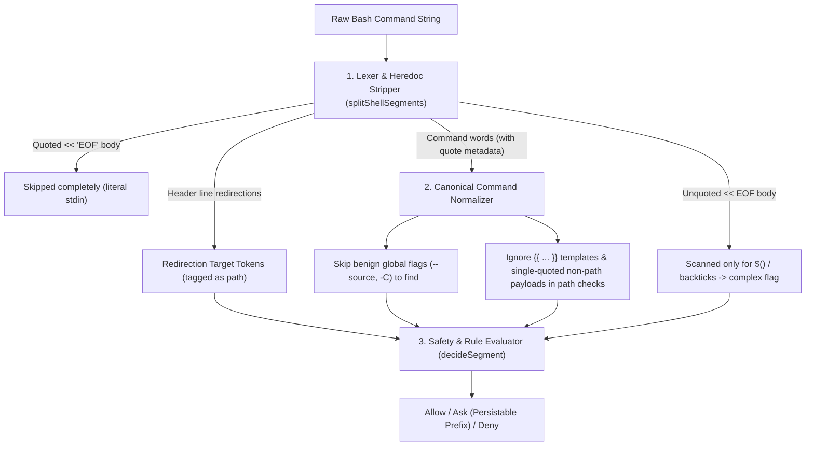

# Plan: Devin/AGY-Style Bash Command Approver (`bootstrap-guard.ts`)

> **Status: Implemented** (`32bf2f1`, CRLF fix in `94d9511`). `bootstrap-guard.ts` was split into `dot_omp/private_agent/extensions/command-guard/{parser,normalizer,rules,store,types,index}.ts`. Phases 1–5 shipped. The prompt shows the normalized prefixes in its session/project/global options, alongside "Yes, once". `bun test scripts/omp-permissions.test.ts`: 43 pass. `docs/debt.md` §3 is marked resolved. Line and function references below describe the pre-split file and are kept for history. Follow-up: the trust tier, part5 Phase 7.

## 1. Problem Analysis (Root Cause of Current Blocking)

In `dot_omp/private_agent/extensions/bootstrap-guard.ts` (tracked in `docs/debt.md` §1 and §3), the shell parser (`splitShellSegments`), command prefix extractor (`commandPrefix`), and hard-check validator (`hardCheckReason`) suffer from four tightly coupled issues:

### A. Heredoc Bodies Are Parsed as Live Shell Commands
`splitShellSegments` treats `<< 'EOF'` or `<< "EOF"` as a standard `<` redirection operator (lines 209–222), then continues parsing every subsequent line (`\n` flushes segments at line 242) until `EOF` as top-level shell commands:
```bash
cat > .scratch/test.tmpl << 'EOF'
{{- $isEphemeral := or (env "CODESPACES") (not stdinIsATTY) -}}
[data]
gitName = {{ $gitName | quote }}
EOF
```
- The parser splits on `\n` and `|` inside the heredoc body.
- It extracts segments like `["{{-", "$isEphemeral", ":=", ...]`, `["quote", "}}"]`, `["[data]"]`, `["EOF"]`.
- Every template line becomes an `unmatched` command, generating bogus approval prompts for template fragments (`{{- $isEphemeral`, `quote }}`, `EOF`).

### B. Unquoted Heredoc Safety vs. Quoted Heredoc Safety
- **Quoted heredocs** (`<< 'EOF'`, `<< "EOF"`, `<<- 'EOF'`, `<<\EOF`) perform **zero shell expansion** in bash/zsh. Their body is strictly literal stdin data—never executed by the shell unless piped into a shell interpreter (`<< 'EOF' | bash`, which is already a separate segment after `|`).
- **Unquoted heredocs** (`<< EOF`) still expand `$(...)`, `` `...` ``, and `$VAR` in bash. Their body is also literal stdin data, **except** if it contains `$(...)` or backticks.

### C. Inline Template Strings Trigger Path & Expansion Heuristics
When passing a template string directly as an argument, e.g.:
```bash
chezmoi execute-template --source . '{{ includeTemplate "agent-core.md" . }}'
```
1. **Quote stripping loses context:** `splitShellSegments` strips outer `'...'` or `"..."` when pushing to `words[]`. Downstream checks cannot distinguish a literal quoted template string `'{{ ... }}'` from an unquoted token.
2. **Prefix matching miss:** `permissions.defaults.json` allows `"chezmoi status"`, `"chezmoi diff"`, `"chezmoi data"`, `"chezmoi cat"`, `"chezmoi verify"`, `"chezmoi managed"`, and `"chezmoi dump"`, but **`"chezmoi execute-template"`** (read-only template rendering to stdout) and **`"chezmoi init"`** (when targeting workspace `.scratch/`) are missing.
3. **False-positive path checks:** `hardCheckReason` inspects every word in `words` (including quoted template arguments or non-flag payloads) with `looksLikePath(word)` and `isProtectedPath(resolved, ...)`. If a template argument or `echo`/`printf` literal contains `~`, `/`, `..`, or `$HOME` (even inside single quotes where `$HOME` isn't expanded), it triggers a non-persistable `path outside workspace` or `protected agent config` block.

### D. Prefix Extraction & Flag Interleaving (`commandPrefix` / `matchesPrefix`)
Currently, `commandPrefix(words)` blindly takes `words.slice(0, 2)` if `words[0]` is in a hardcoded `SUBCOMMAND_TOOLS` list, or `words[0]` otherwise.
- **Flag interleaving breaks prefix matching:** `git -C . status` or `chezmoi --source . data` has `words = ["chezmoi", "--source", ".", "data"]`. `matchesPrefix` checks `words[0..1]` against `"chezmoi data"`, which **fails** because `--source .` sits before the subcommand `data`, resulting in `chezmoi --source` being sent as an unmatched approval target!
- **Over-specific single-word vs. two-word behavior:** Devin and AGY normalize a command to its canonical `<binary> <subcommand>` (first two non-flag tokens after leading env vars, or `<binary>` when the second token is a path/flag/argument for a single-verb tool like `ls`, `cat`, `mkdir`, `touch`, `cp`, `mv`).

---

## 2. Design Goals (Devin / AGY Parity + Safety Guardrails)

1. **Quoted Heredocs & Template Payloads Ignored as Commands:**
   - Quoted heredocs (`<< 'EOF'`, `<< "EOF"`, `<<\EOF`, `<<-'EOF'`) consume their body through the closing delimiter line without emitting shell segments or triggering `complex`.
   - Unquoted heredocs (`<< EOF`, `<<- EOF`) also consume their body (do not emit lines as command segments), but scan the body **only** for unescaped `$(...)` or `` `...` `` to set `complex = true`.
   - Single-quoted arguments and Go/Chezmoi template literals (`{{ ... }}`) are tagged as literal data so they never trigger `looksLikePath` or `$HOME` expansion checks.
2. **Canonical 1–2 Token Command Signature (Flag-Aware):**
   - Strip leading env assignments (`FOO=bar`) and skip benign global option flags before the subcommand (e.g., `chezmoi --source . data` → canonical prefix `chezmoi data`; `git -C path status` → canonical prefix `git status`, while keeping `git -c` blocked).
   - Default to `<bin> <subcommand>` (2 parts) for multi-subcommand CLIs (or `<bin> <verb> <target>` for `npm run <script>`), and `<bin>` (1 part) when all trailing tokens are flags or file/template arguments.
3. **Preserve Hard Safety Boundaries (Unless User Overridden):**
   - Redirection targets (`> file`, `>> file`) are always extracted and checked against `isProtectedPath` and `workspaceRoots`, even on commands with heredocs (`cat > /etc/passwd << 'EOF'` still blocks on `/etc/passwd`!).
   - Piping a heredoc into an interpreter (`cat << 'EOF' | bash`) still splits on `|` on the header line and evaluates `bash` as a separate segment.
   - `complex` command substitutions (`$(...)`, `` `...` ``, `<(...)`), `eval`, `xargs`, `bash -c`, `find -exec/-delete`, `git -c`, and protected `.omp` paths remain gated.
   - Allow user session/project/global overrides (`allow`, `allowOutside`, `allowedPaths`) to cleanly persist normalized command prefixes without re-prompting on every flag variation.

---

## 3. Architecture & Step-by-Step Implementation Plan



### Phase 1: Rich Token Metadata & Heredoc-Aware `splitShellSegments`
Update `splitShellSegments` in `dot_omp/private_agent/extensions/bootstrap-guard.ts`:

1. **Token Representation (Internal):**
   Track token metadata alongside word strings (or return `RichWord { text: string; quote?: "'" | '"' | "mixed"; isRedirectTarget?: boolean }`, keeping `splitShellSegments(cmd).segments: string[][]` backward-compatible for existing tests while exposing `parseShellSegments(cmd)` for `decideSegment`).
2. **Heredoc Detection (`<<` and `<<-`) vs. Here-String (`<<<`):**
   - When encountering `<` at `index`:
     - If `command[index + 1] === "<"` and `command[index + 2] !== "<"`:
       - Advance past `<<` (and optional `-`).
       - Skip horizontal whitespace (`[ \t]`).
       - Parse the delimiter token up to whitespace/operator/newline, recording whether any part of the delimiter was quoted (`'...'`, `"..."`, or `\`) → `heredocQuoted: boolean`, and the unquoted delimiter string (e.g. `EOF`).
       - Queue `{ delimiter, quoted: heredocQuoted, stripTabs: hasDash }` into `pendingHeredocs` for the current physical line.
       - **Important:** Do **not** consume the rest of the current line yet! Commands like `cat << 'EOF' > .scratch/out.txt | grep foo` have redirections and pipes on the same line after `<< 'EOF'`.
     - When encountering `\n` while `pendingHeredocs.length > 0`:
       - Flush the current segment (or keep reading if mid-pipeline).
       - For each queued heredoc in order, advance `index` line-by-line until a line matches `delimiter` (with leading `\t*` stripped if `stripTabs` is true).
       - If `!heredoc.quoted`, scan the consumed body for unescaped `$(` or `` ` `` and set `complex = true` if found.
       - Never emit any tokens or segments from the heredoc body.
     - For `<<<` (here-string): treat the following word as a normal string argument (not a file path redirection target).

### Phase 2: Template & Quoted Argument Filtering in `hardCheckReason`
Prevent template syntax and literal string payloads from masquerading as filesystem paths:

1. **Template Expression Guard (`isTemplateLiteral`):**
   - Any argument containing `{{` and `}}` (Go/Chezmoi/Jinja template blocks) or starting with `{{-` / `}}` is recognized as a template expression, **not** a filesystem path.
   - Skip `looksLikePath` on template literals (unless the token is explicitly a shell redirection target like `> {{foo}}`).
2. **Single-Quoted `$HOME` Guard:**
   - In bash, single-quoted `'...$HOME...'` does **not** expand `$HOME`. Only unquoted or double-quoted `$HOME` / `${HOME}` expands.
   - Only trigger `looksLikePath` on `$HOME` / `${HOME}` when the token was not single-quoted, or when it starts with `/`, `~/` (unquoted), or `..`.
3. ** Explicit Redirection Target Validation:**
   - Tag every token immediately following `>`, `>>`, `>|`, `&>`, `&>>`, `<`, `<>` as `isRedirectTarget = true`.
   - Redirection targets are **always** checked against `isProtectedPath` and `workspaceRoots` (even if they don't start with `/`, `~`, or `..`—though relative paths inside `cwd` resolve within `workspaceRoots` and pass, unless they hit `.omp/permissions.json`).

### Phase 3: Flag-Aware Subcommand Normalization (`canonicalWords` & `commandPrefix`)
Make command matching behave like Devin / AGY when flags precede subcommands:

1. **Subcommand-Seeking Normalizer (`extractCommandSignature`):**
   - For tools in `SUBCOMMAND_TOOLS` (`git`, `chezmoi`, `mise`, `docker`, `kubectl`, `gh`, `cargo`, `uv`, `npm`, `bun`, `pnpm`, `yarn`, `just`):
   - Scan past benign global flags between `words[0]` and the subcommand:
     - Known value-taking global flags:
       - `chezmoi`: `--source`, `-S`, `--config`, `-c`, `--destination`, `-D`, `--working-tree`, `-W`, `--override-data` (and their `--flag=value` forms).
       - `git`: `-C`, `--git-dir`, `--work-tree`, `--namespace` (**never** `-c` or `--config-env`, which remain hard-checked in `hardCheckReason`).
       - `docker` / `kubectl`: `--context`, `-n`, `--namespace`, `--kubeconfig`.
       - `just`: `-f`, `--justfile`, `-d`, `--working-directory`.
     - Known boolean global flags: `--no-tty`, `--no-pager`, `-v`, `--verbose`, `-q`, `--quiet`, `--color=*`.
   - Construct `canonicalWords = [words[0], subcommand, ...rest]` for `matchesPrefix` and `commandPrefix`.
   - Result:
     - `chezmoi --source="${repository_root}" execute-template ...` → canonical prefix **`chezmoi execute-template`**.
     - `chezmoi init --source=. --config=.scratch/test.toml` → canonical prefix **`chezmoi init`**.
     - `git -C subrepo status -s` → canonical prefix **`git status`**.
2. **Devin-Style 2-Part Fallback for Unknown Commands:**
   - If `words[0]` is **not** in `SUBCOMMAND_TOOLS`:
     - If `words[1]` exists and is a bare subcommand-like identifier (`/^[a-z][a-z0-9_-]*$/`—not a flag `-...`, not a path containing `/` or `.`, not an assignment), `commandPrefix` can optionally return `words.slice(0, 2).join(" ")` or `words[0]`.
     - Keeping 1-word prefixes (`mkdir`, `touch`, `cp`, `mv`, `cat`, `find`) for standard POSIX file utilities and 2-word prefixes (`<tool> <subcommand>`) for CLI tools matches Devin/AGY ergonomics so approving `mkdir` once covers `mkdir -p .scratch`, while approving `chezmoi init` only covers `chezmoi init` and not `chezmoi apply`.

### Phase 4: Default Permissions & Safe Workspace Utilities (`permissions.defaults.json`)
Reduce unnecessary prompt friction for safe, workspace-confined operations (still guarded by `hardCheckReason` against outside-workspace paths and protected `.omp` files):

1. **Add Read-Only / Template Inspection Subcommands to `allow`:**
   - `"chezmoi execute-template"` (evaluates templates to stdout; cannot mutate outside workspace without `>` which is checked).
   - `"chezmoi archive"`, `"chezmoi state"`, `"chezmoi ignored"`, `"chezmoi unmanaged"`.
2. **Add Workspace-Confined File Utilities to `allow` (Optional / Configurable):**
   - `"mkdir"`, `"touch"`, `"cp"`, `"mv"`, `"cat"`, `"printf"`, `"true"`, `"false"`, `"test"`, `"["`, `"basename"`, `"dirname"`, `"realpath"`, `"mktemp"`, `"sort"`, `"uniq"`, `"tr"`, `"cut"`, `"diff"`, `"comm"`, `"sha256sum"`, `"shasum"`.
   - *Why this is safe:* `hardCheckReason` runs **before** `allow` rules (`bootstrap-guard.ts:432`). Any attempt to run `mkdir /tmp/evil`, `cp foo ../outside`, `cat ~/.ssh/id_rsa`, or `touch .omp/permissions.json` is intercepted by `hardCheckReason` (`path outside workspace` or `protected agent config`) and forced to a non-persistable `ask`. Inside the workspace (and `.scratch/`), these basic utilities stop interrupting the user.
   - Destructive commands (`rm`, `chmod`, `chown`, `dd`, `find -delete`) remain in `ask`.

### Phase 5: Other High-Value Improvements to `bootstrap-guard.ts`
While touching `bootstrap-guard.ts`, we can close several subtle edge cases:

1. **Compound Loop/Conditional Keywords Stripping:**
   - When a pipeline or multiline script uses `if cmd; then body; fi` or `for x in a b; do body; done`, `then`, `fi`, `do`, `done`, `else`, `elif` currently land as `words[0]` of their segment and trigger `unmatched` prompts (`then`, `fi`, `done`).
   - Strip leading shell reserved flow keywords (`if`, `then`, `elif`, `else`, `fi`, `while`, `until`, `do`, `done`, `!`, `{`, `}`) at the start of a segment in `flushSegment` (and handle `for <var> in ...;` header segments cleanly) so simple loops in bash calls only evaluate the actual commands inside the loop!
2. **Comment Filtering (`# ...`):**
   - Currently `splitShellSegments` has **no `#` comment handling**! An unquoted `# comment` line in a multi-line bash call is parsed as command `#` with words `["#", "comment", ...]` and triggers an `unmatched` prompt!
   - Fix: When unquoted `#` appears at the start of a segment or after whitespace/delimiters (`\s`, `;`, `\n`, `&`, `|`), skip to the end of the line (`\n`).
3. **Granular Approval Options in UI Prompt:**
   - When prompting for an unmatched command or `ask` rule, show the normalized prefix clearly in the prompt header (`Command prefix: chezmoi init`) and, if a multi-word command is unmatched, allow approving either the specific subcommand (`chezmoi init`) or the exact command once.

---

## 4. Verification & Test Plan (`scripts/omp-permissions.test.ts`)

1. **Unit Tests to Add in `scripts/omp-permissions.test.ts`:**
   - **Quoted Heredocs:**
     - `cat > .scratch/test.toml.tmpl << 'EOF'\n{{- $x := env "FOO" | quote -}}\n[data]\nEOF` → produces **1 segment** (`["cat", ".scratch/test.toml.tmpl"]`), `complex === false`, decision `allow` (if `cat` is allowed) or single `cat` check, zero segments for template lines.
     - `cat << "EOF" | grep foo\nbar | baz\nEOF` → produces **2 segments** (`["cat"]`, `["grep", "foo"]`), `complex === false`.
     - `cat > /etc/hosts << 'EOF'\n127.0.0.1 evil\nEOF` → blocked by `path outside workspace: /etc/hosts`.
   - **Unquoted Heredocs:**
     - `cat << EOF\nhello world\nEOF` → 1 segment (`["cat"]`), `complex === false`.
     - `cat << EOF\n$(whoami)\nEOF` → 1 segment (`["cat"]`), `complex === true` (prompts user).
   - **Inline Templates:**
     - `chezmoi execute-template --source . '{{ includeTemplate "agent-core.md" . }}'` → 1 segment, normalized prefix `chezmoi execute-template`, no false-positive path or complex triggers, decision `allow`.
     - `chezmoi execute-template '{{ $HOME }}'` (single-quoted) → does not trigger `path outside workspace`.
   - **Global Flag Skipping:**
     - `chezmoi --source="${repo}" --config="${cfg}" data` → matches `chezmoi data` (`allow`).
     - `git -C subrepo status` → matches `git status` (`allow`).
     - `git -c core.sshCommand=evil status` → still blocked by `git -c` hard check!
   - **Comments & Shell Keywords:**
     - `# setup config\ngit status` → 1 segment (`["git", "status"]`), `#` comment ignored.
     - `if git status; then echo ok; fi` → 2 segments (`["git", "status"]`, `["echo", "ok"]`), decision `allow`.
2. **Retire Debt Item:**
   - Remove or mark resolved **Section 3 (Template Tokens in Command Approval Guard)** in `docs/debt.md`.
3. **CI Validation:**
   - Run `bun test scripts/omp-permissions.test.ts` and `just test-fast`.
